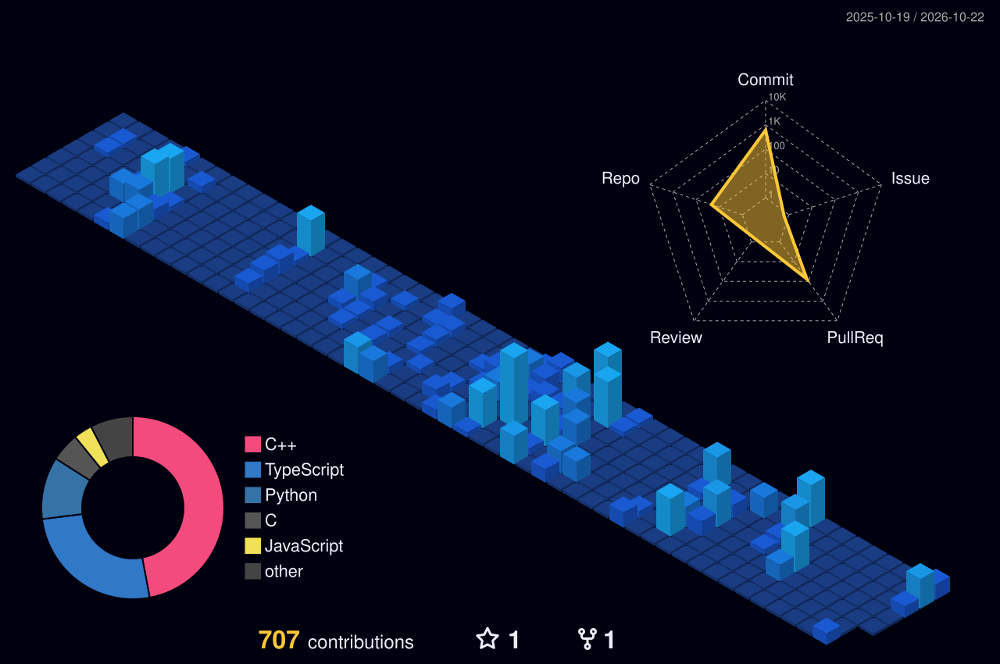

  

    

  

  

    CS student at <b>Institut Teknologi Bandung (ITB)</b>. 
    Competitive programmer at heart, currently spending most of my time learning and diving deep into <b>Artificial Intelligence & Machine Learning</b>. Love tackling complex algorithmic puzzles, mathematical modeling, and applying algorithms to intelligent systems.
  

  

**`Informatics @ ITB | Competitive Programming | AI/ML`**

 

`C++` `Python` `C` `Graph Theory` `DP` `Machine Learning`

  

 

### Competitive Programming

- **ICPC Asia Jakarta Onsite Regional Contest (2025)** — Honorable Mention.
- **Active Competitor on [Codeforces](https://codeforces.com/profile/jonathankw2005)** — Solved 1,500+ algorithmic problems spanning dynamic programming, graph theory, combinatorics, and advanced data structures.

 

### Featured Projects

#### AI & Intelligent Systems
- **[Antizero-Chess](https://github.com/Joji0/Antizero-Chess)** — High-performance UCI-compliant chess engine in C++17. Implements bitboard board representations, magic bitboard attack generation, evaluation heuristics, and alpha-beta pruning search.
- **[Automemoir](https://github.com/Joji0/Automemoir-Pattern-Matcher)** — Chromium extension (Manifest V3) for automated pattern matching, text censorship, and computer vision / OCR integration via Tesseract.
- **[VoidReach](https://github.com/Joji0/VoidReach)** — Real-time Inverse Kinematics (IK) engine for planar robotic arms in C++17 using Damped Least Squares optimization and raylib visualization.

#### Algorithms & Mathematics
- **[3D-Object-Surface-Voxelizer](https://github.com/Joji0/3D-Object-Surface-Voxelizer)** — Fast 3D mesh voxelizer in C++17 utilizing Octree spatial partitioning, exact SAT collision pruning, and custom SFML software rasterizer.
- **[Chromatic-Polynomial](https://github.com/Joji0/Chromatic-Polynomial)** — Academic research paper and C++17 benchmark computing graph chromatic polynomials via subset dynamic programming and Lagrange interpolation.
- **[VoidWrap](https://github.com/Joji0/VoidWrap)** — Interactive 2D Convex Hull visualizer and benchmark suite in vanilla JS & HTML5 Canvas (Graham Scan, Jarvis March, QuickHull).
- **[Algorithmic-Graph-Theory](https://github.com/Joji0/Algorithmic-Graph-Theory)** — Interactive 2D/3D graph algorithm playground, world-map TSP solver, and edge-colouring timetable scheduler (React, Three.js).

#### Software & Systems
- **[PhigrOS](https://github.com/Joji0/PhigrOS)** — 32-bit x86 monolithic kernel built from bare metal for OS coursework. Preemptive Round-Robin scheduling (100 Hz PIT timer), 4MB PSE paging, full EXT2 filesystem driver, and interactive VGA shell.
- **[Arion-Compiler](https://github.com/Joji0/Arion-Compiler)** — End-to-end optimizing compiler and bytecode stack machine VM in C++17 with DFA lexer, LL(1) parser, and TAC P-Code intermediate representation.
- **[VoidAutoKey](https://github.com/Joji0/VoidAutoKey)** — Full-stack keyboard shortcut manager and keybind optimizer powered by Trie search, Levenshtein matching, and 0/1 Knapsack DP.
- **[Groddit](https://github.com/Joji0/Groddit)** — Terminal-based Reddit clone in C99 with modular custom ADTs (Graph, Min-Heap, PostTree, Trie, LCG cipher).

 

  

 

### Technologies

  

 

### GitHub Analytics

  
  
    
  

 

  

 

  

 

### Connect

  <a href="https://codeforces.com/profile/jonathankw2005"><b>Codeforces</b></a> &nbsp;•&nbsp;
  <a href="https://www.linkedin.com/in/jonathan-kris/"><b>LinkedIn</b></a> &nbsp;•&nbsp;
  <a href="mailto:jonathankw2005@gmail.com"><b>Email</b></a>

